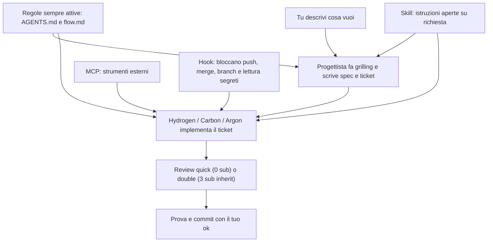

# Guida pratica: modelli, branching e flusso di lavoro

Manuale rapido per l'uso quotidiano. Le regole compatte lette a ogni turno stanno in [`flow.md`](flow.md); le procedure complete stanno nelle skill [`flow-design`](skills/flow-design/SKILL.md) e [`implement-ticket`](skills/implement-ticket/SKILL.md). Il vocabolario è in [`GLOSSARY.md`](GLOSSARY.md), la mappa delle skill in [`docs/skills.md`](docs/skills.md) e l'installazione in [`SETUP.md`](SETUP.md).

## 1. Cosa scrivere in base a cosa stai facendo

| Sto per... | Dove | Cosa scrivo |
|---|---|---|
| Progettare una funzione nuova | Progettista (Claude / Carbon) | `/grill-with-docs` + idea in 2-3 righe |
| Affrontare un lavoro grande o nebbioso | Progettista | `/wayfinder` + obiettivo |
| Correggere un bug | Claude (`Opus`) | `/diagnosing-bugs` + sintomo e passi |
| Capire un modulo del progetto | Ovunque | `Spiegami <file>` (risponde in chat e aggiorna `docs/`) |
| Trovare dove pulire l'architettura | Claude / Antigravity | `/improve-codebase-architecture <area>` |
| Implementare un ticket, dall'inizio al commit | Antigravity | `Implementa il ticket <N>` |
| Rilanciare la review su un diff | Antigravity | `Rivedi il ticket <N>` |
| Vedere i ticket, chi li implementa e perché | Progettista | `Tabella dei ticket` |
| Capire cosa è stato fatto | Claude o Antigravity | `Spiegami il flusso di <cosa>` |
| Sapere da dove viene un'affermazione | Ovunque | `Qual è la fonte?` |
| Sapere quale skill usare | Ovunque | `/ask-matt <situazione>` oppure leggi [`docs/skills.md`](docs/skills.md) |
| Chiarire una risposta confusa | Claude | `/wait-what` |
| Controllare novità cross-PC e skill subito | Terminale | `python -X utf8 -I scripts/check-updates.py` |
| Aggiornare skill, plugin e MCP | Claude | `Aggiorna il setup seguendo SETUP.md` |
| Cercare MCP utili per te | Claude | `Cerca MCP utili seguendo SETUP.md` |
| Analizzare o allineare un progetto | Claude | `Analizza/Allinea questo repo seguendo SETUP-REPO.md` |

## 2. Modelli reali (Casa Pro vs Ufficio Ultra)

| Ruolo | Casa (`Claude Pro` + `AGY Pro`) | Ufficio (`Claude Team` + `AGY Ultra`) | Quando si usa |
|---|---|---|---|
| **Progettista** | `Sonnet 5.5 medium` (default), `Opus` | `Sonnet 5.5 medium` (default), `Opus`, `Carbon Medium` | `aim-higher`, grilling, spec, ticket e diagnosi bug difficili |
| **Esecutore meccanico** | `Hydrogen Low` | `Hydrogen Low` | Ritocchi <= 30 righe, costanti, rinomine, testi senza nuovo stato |
| **Esecutore standard** | `Hydrogen Medium` (default) | `Hydrogen Medium` (default) | Logica, configurazioni e UI dove compilatore o test mostrano gli errori |
| **Esecutore critico (`C = 1`)** | `Argon Medium` | `Carbon Medium` | Thread, async, hook di sicurezza, script sync, scelte aperte |
| **Subagenti ricerca Claude** | `Sonnet high`, `Haiku` | `Sonnet high`, `Haiku` | `Sonnet high` per doc/web e `contrarian`; `Haiku` per file/simboli |
| **Revisori (`Review: double`)** | 3 subagenti su `inherit` | 3 subagenti su `inherit` | `Standards`, `Spec` e `ponytail-review` sullo stesso modello del ticket |

Il progettista scrive la scelta nella riga `Esecutore:` di ogni ticket. Se l'esecutore fallisce due volte la stessa verifica, si sale di un gradino (`Hydrogen Low` -> `Hydrogen Medium` -> `Hydrogen High` -> `Carbon Medium` o `Argon Medium`) in una chat pulita; errori di strumenti o build si sistemano leggendo i log, senza cambiare modello.

## 3. Branching cross-PC e ciclo di un lavoro

1. **Crea il branch (sempre tu, mai l'agente).** Usa 3 livelli tutti minuscoli stile IDEA: `office/<tipo>/<slug>` in Ufficio e `home/<tipo>/<slug>` a Casa, con `<tipo>` tra `feat`, `fix`, `refactor`, `docs`, `test`, `chore`. Gli hook bloccano agli agenti creazione, checkout e merge dei branch.
2. **Progetta.** Con `flow-design` (`/grill-with-docs`, `/to-spec`, `/to-tickets`) l'AI raccoglie evidenze (`aim-higher`), chiarisce i dubbi, scrive `.scratch/<lavoro>/spec.md` e i ticket verticali in `.scratch/<lavoro>/issues/`. Se c'è più di un ticket e non sono tutti `quick`, l'agente `contrarian` in Claude esegue il premortem sui ticket con prove riapribili.
3. **Implementa in una chat pulita.** Imposta in Antigravity modello e livello dalla riga `Esecutore:`, poi scrivi `Implementa il ticket 01`. L'esecutore legge il ticket e `AGENTS.md`, lancia i test esistenti prima di toccare codice, applica modifiche chirurgiche e aggiorna `docs/`.
4. **Review binaria (`quick` o `double`).** La metrica `S/G/C` decide la review:
   - **`Review: quick` (`S/G/C = 0/0/0`):** 0 subagenti; bastano build/test verdi, controllo `docs/` e auto-verifica.
   - **`Review: double` (almeno un bit `= 1`):** 3 subagenti paralleli a contesto pulito su `inherit` (`Standards` + `Spec` + `ponytail-review`); l'esecutore verifica sul codice reale, scarta i falsi positivi e corregge in una passata.
5. **Walkthrough, prova e commit.** L'AI scrive `## Answer` nel ticket e ti presenta il Walkthrough. Dopo il tuo ok (`Committo?`), scrive `Status: resolved` (prima del commit nei repo versionati; subito dopo con `Commit: <hash>` nei repo ibridi) e committa. Per il ticket successivo apri sempre una chat pulita.
6. **Chiusura branch e sync tra PC.** A fine spec integri il branch su `main` con merge non-squash (`--no-ff` o Merge PR) e cancelli il branch remoto/locale (`fetch.prune=true` riallinea l'altro PC). Gli hook `post-merge`, `post-checkout` e `post-rewrite` riallineano subito `~/.gemini/config/`.

## 4. Controllo silenzioso 8h / 24h

All'avvio di Claude Code o Antigravity, `scripts/session_check.py` legge `~/.just-develop-local/update-state.json` in meno di 50 ms senza toccare la rete: se non ci sono novità non aggiunge nulla al contesto; se presenti, segnala gli aggiornamenti e avvia `scripts/background_checker.py` in un processo staccato con lock kernel OS:

- **Ogni 8 ore (Git cross-PC):** esegue `git fetch --prune origin`, verifica lo stato rispetto a `origin/main`, rileva collisioni case-insensitive tra nomi di branch e controlla eventuali sovrapposizioni sui branch fratelli aperti (`office/*`, `home/*`), verificando prima `git status --porcelain` (esclusa `.scratch/`) e poi `git merge-tree`.
- **Ogni 24 ore (Skill, Plugin, MCP):** esegue `git ls-remote` sui repository tracciati in `~/.agents/.skill-lock.json` e sui cloni plugin abilitati, senza consumare limiti REST API GitHub.
- **Quando vuoi verificare subito:** esegui `python -X utf8 -I scripts/check-updates.py`.

## 5. Cosa ti viene mostrato e comandi utili

| Quando | Chi | Cosa ricevi |
|---|---|---|
| Fine progettazione | Progettista + `contrarian` | Obiezioni con prova da accogliere o scartare, tabella dei ticket (più rischiosi prima) e `flowchart TD` delle dipendenze |
| Fine ticket | Esecutore | Walkthrough in 5 sezioni: effetto pratico, `flowchart TD`, tabella API/parametri/flag/unità, schede SMIG e prova manuale HITL |
| Fine lavoro | Progettista | `flowchart TD` del flusso toccato e tabella `Cosa | Perché | Fonte` |

| Vuoi... | Scrivi o esegui |
|---|---|
| Capire il perché completo | `spiegami il perché` |
| Verificare tutto il setup in locale | `python -X utf8 -I tests/run.py` |
| Verificare aggiornamenti cross-PC e skill ora | `python -X utf8 -I scripts/check-updates.py` |
| Vedere la guida web in locale | `npx mint dev --port 3333` dentro `docs/` |

## 6. Se parti da zero

Questa sezione spiega i mattoni del setup. Puoi chiedere `Spiegami <concetto> con un esempio sul mio lavoro` in ogni momento.

| Concetto | Cos'è | Quando serve | Fonte |
|---|---|---|---|
| Regole | Testo caricato a ogni turno | Poche invarianti che servono ovunque | [Anthropic, Memory](https://code.claude.com/docs/en/memory), [Google, Rules](https://antigravity.google/docs/rules/) |
| Skill | Istruzioni in una cartella, lette solo quando servono | Procedure ripetute (design, ticket, review, docs) | [Google, Agent skills](https://antigravity.google/docs/skills/), [Matt Pocock](https://github.com/mattpocock/skills) |
| Hook | Script prima o dopo un'azione o comando Git | Controlli deterministici (branch, segreti, format commit, sync) | [Anthropic, Hooks](https://code.claude.com/docs/en/hooks), [Google, Hooks](https://antigravity.google/docs/hooks/) |
| Subagente | Istanza parallela a contesto pulito | Ricerche ampie, `contrarian`, 3 assi di `Review: double` | [Anthropic, Subagents](https://code.claude.com/docs/en/sub-agents), [Google, Subagents](https://antigravity.google/docs/subagents) |
| Spec e ticket | Contratto su disco in `.scratch/` | Ogni lavoro che supera un ritocco immediato | [`flow.md`](flow.md), [`GLOSSARY.md`](GLOSSARY.md) |

Le ragioni tecniche di ogni scelta, con pro e contro, sono in [`DECISIONS.md`](DECISIONS.md).
