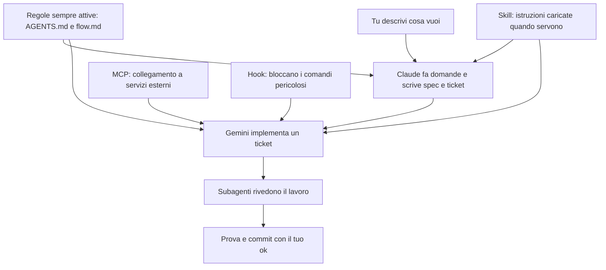

# Guida pratica: lavorare con Opus, Sonnet e Gemini

Manuale rapido per te. Le regole che leggono i modelli sono in [`flow.md`](flow.md) (sempre attivo) e [`flow-prompts.md`](flow-prompts.md). Il significato di ogni termine è in [`GLOSSARY.md`](GLOSSARY.md). Installazione e aggiornamenti li fa l'agente leggendo [`SETUP.md`](SETUP.md).

## 1. Cosa scrivere in base a cosa stai facendo

| Sto per… | Dove | Cosa scrivo |
|---|---|---|
| Progettare una funzione nuova | Claude Code (Opus) | `/grill-with-docs <idea in 2-3 righe>` |
| Affrontare un lavoro grande o nebbioso | Claude Code (Opus) | `/wayfinder <obiettivo>` |
| Correggere un bug | Claude Code (Opus `high`) | `/diagnosing-bugs` + sintomo e passi |
| Capire un modulo del progetto | Ovunque | `Spiegami <file>` (risponde in chat e aggiorna la pagina in `docs/`) |
| Trovare dove pulire l'architettura | Claude Code / Antigravity | `/improve-codebase-architecture <area>` |
| Implementare un ticket, dall'inizio al commit | Antigravity | `Implementa il ticket <N>` |
| Rilanciare la review su un diff | Antigravity | `Rivedi il ticket <N>` |
| Vedere i ticket, chi li implementa e perché | Claude Code | `Tabella dei ticket` |
| Capire cosa è stato fatto | Claude Code o Antigravity | `Spiegami il flusso di <cosa>` |
| Sapere da dove viene un'affermazione | Ovunque | `Qual è la fonte?` |
| Sapere quale skill usare | Ovunque | `/ask-matt <situazione>` |
| Chiarire una risposta confusa | Claude Code | `/wait-what` |
| Aggiornare skill, plugin e MCP | Claude Code | `Aggiorna il setup seguendo SETUP.md` |
| Cercare MCP utili per te | Claude Code | `Cerca MCP utili seguendo SETUP.md` |
| Capire come migliorare gli agenti su un repo | Claude Code | `Analizza questo repo seguendo SETUP-REPO.md` |
| Preparare un repo nuovo o riordinarne uno | Claude Code | `Allinea questo repo seguendo SETUP-REPO.md` |

## 2. Chi fa cosa

| Modello | Quando | Livello |
|---|---|---|
| **Opus** (Claude Code) | Decisioni, grilling, spec, ticket, bug difficili | `high` per decisioni costose da annullare, `medium` per il resto |
| **Gemini Flash** (Antigravity) | Esecutore di default, quando un errore si vede da test o build | `Medium`; `Low` solo per modifiche meccaniche; `High` come gradino dopo due fallimenti |
| **Gemini Argon** (Antigravity) | Ticket dove un errore passa i test e si scopre tardi | `Medium`; nel selettore può partire da `High`, controlla prima di iniziare |
| **Sonnet** (subagente Claude) | Ricerche su documentazione e web | `high` |
| **Haiku** (subagente Claude) | Cercare file o simboli nel codice | predefinito |

Opus scrive la scelta per ogni ticket nella riga `Esecutore:`.

## 3. Il ciclo di un lavoro

1. **Decidi con Claude.** `/grill-with-docs`, poi `/to-spec` e `/to-tickets`; alla fine l'agente `contrarian` prova a smontare i ticket e tu scegli quali obiezioni accogliere. I ticket finiscono in `.scratch/<lavoro>/issues/`, sul branch della spec.
2. **Implementa con Gemini.** Chat pulita, modello e livello dalla riga `Esecutore:`, poi `Implementa il ticket 01`. Resti lì fino al commit.
3. **Review automatica.** Con `Review: double` Gemini lancia 3 subagenti e corregge da solo. Con `Review: quick` bastano build, test e `docs/`.
4. **Prova.** Gemini aggiorna `.scratch/`, ti mostra il Walkthrough e, se serve, i passi da provare.
5. **Commit.** Sul branch della spec, dopo il tuo ok. Per il ticket dopo apri una sessione nuova; il merge su `main` lo fai tu a spec finita.

Mentre Gemini lavora puoi progettare la spec successiva con Claude.

## 4. Cosa ti viene mostrato

| Quando | Chi | Cosa ricevi |
|---|---|---|
| Fine di `/to-tickets` | Claude, con l'agente `contrarian` | Le obiezioni ai ticket, ognuna con la sua prova, da accogliere o scartare; poi la tabella dei ticket: titolo, prompt, modello e livello, review, perché; sotto, il `flowchart TD` delle dipendenze |
| Fine ticket | Gemini | Walkthrough: effetto in 2 frasi, `flowchart TD`, API e flag con la fonte, spiegazione dei passaggi, prova manuale |
| Fine di un lavoro | Claude | `flowchart TD` del flusso toccato e tabella `Cosa, Perché, Fonte` |

La mappa di tutto il setup è in [`docs/index.mdx`](docs/index.mdx).

## 5. Comandi utili

| Vuoi… | Scrivi |
|---|---|
| Capire il perché completo | `spiegami il perché` |
| Far controllare bug, rischi e codice superfluo (in Antigravity) | `/ponytail-review uncommitted` |
| Vedere le scorciatoie rimandate nel codice | `/ponytail-debt` |
| Vedere la documentazione in locale | `npx mint dev --port 3333` dentro `docs/` |

## 6. Se parti da zero

Questa sezione la usa anche l'agente durante il setup. Puoi chiedergli `Spiegami <concetto> con un esempio sul mio lavoro` in ogni momento.

### Come si incastrano i pezzi

### I concetti

| Concetto | Cos'è | Quando serve | Dove approfondire |
|---|---|---|---|
| Regole | Testo che l'agente ha sempre davanti | Poche indicazioni che non troverebbe da solo | [Anthropic, Memory](https://code.claude.com/docs/en/memory), [Google, Rules](https://antigravity.google/docs/rules/) |
| Skill | Istruzioni specializzate in una cartella, lette quando servono | Procedure che si ripetono | [Google, Agent skills](https://antigravity.google/docs/skills/), [skill di Matt Pocock](https://github.com/mattpocock/skills) |
| Plugin | Un pacchetto che può portare skill e hook | Installare e aggiornare tutto insieme | `SETUP.md`, sezione Fonti |
| Hook | Script che gira prima di un'azione e può bloccarla | Ciò che deve accadere sempre | [Anthropic, Hooks](https://code.claude.com/docs/en/hooks), [Google, Hooks](https://antigravity.google/docs/hooks/) |
| MCP | Collegamento tra l'agente e strumenti esterni | Dati o azioni che dal repo non si raggiungono | [MCP, sicurezza](https://modelcontextprotocol.io/docs/2026-07-28/tutorials/security/security_best_practices) |
| Subagente | Un'altra istanza con un contesto pulito | Ricerche lunghe e review indipendenti | [Anthropic, Subagents](https://code.claude.com/docs/en/sub-agents), [Google, Subagents](https://antigravity.google/docs/subagents) |
| Spec e ticket | Cosa costruire, spezzato in pezzi piccoli e verificabili | Ogni lavoro che non sia banale | `flow.md`, `GLOSSARY.md` |

Le pagine sono state lette l'8/11/2026. Quella sulla sicurezza MCP è un'anteprima di ricerca.

### Da vibe coding a spec

Nel vibe coding chiedi, accetti e speri. Qui decidi prima il comportamento, poi l'agente lo implementa e una verifica dice se funziona.

| Chi | Cosa guardare | Fonte |
|---|---|---|
| Matt Pocock | Le skill su cui si basa questo flusso | [README](https://github.com/mattpocock/skills) |
| antirez | Controllare idee e test | [Blog, luglio 2026](https://antirez.com/news/169) |
| Karpathy | Ispezionare i diff; la fonte è una sintesi AI riletta da lui | [Sequoia Ascent, aprile 2026](https://karpathy.bearblog.dev/sequoia-ascent-2026/) |
| Superpowers | Un ticket che basti a chi non ha contesto | [README](https://github.com/obra/superpowers) |

Le ragioni di ogni scelta, con pro e contro, sono in `DECISIONS.md`.

### Cosa provare

1. Scrivi `Spiegami il flusso di una modifica su questo repo`.
2. Prendi una modifica piccola e reale, e lancia `/grill-with-docs <idea>`.
3. Quando qualcosa non ti torna, scrivi `Qual è la fonte?` oppure `Proponi un modo migliore`.
