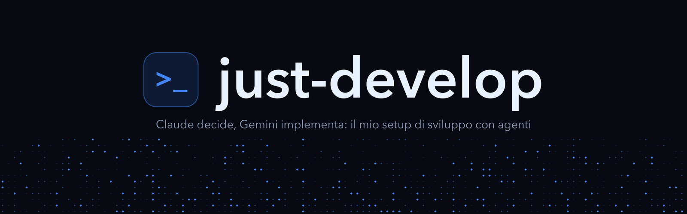

<p align="center"></p>

# just-develop

Setup pubblico di sviluppo con agenti per Claude Code e Antigravity: progettazione guidata su disco (`.scratch/`), implementazione isolata per ticket, review binaria (`quick` o `triple`) e documentazione in `docs/`.

Per scegliere subito quale skill usare a ogni passo, apri la [guida alle skill](docs/skills.md). Per i comandi quotidiani vedi [`GUIDE.md`](GUIDE.md).

## Iniziare

Apri Claude Code in questa cartella e scrivi:

```text
Leggi SETUP.md e installa il setup.
```

Lo stesso file copre anche `Aggiorna il setup` e `Cerca MCP utili per me`.

## Cosa c'è

| File | A cosa serve |
|---|---|
| [`SETUP.md`](SETUP.md) | Istruzioni per l'agente: installazione, aggiornamenti, ricerca MCP |
| [`SETUP-REPO.md`](SETUP-REPO.md) | Analizza e allinea un progetto (`Repo versionato` o `Repo ibrido`) |
| [`flow.md`](flow.md) | Nucleo sempre attivo: ruoli, modelli, branching, puntatori e chiusura ticket |
| [`GUIDE.md`](GUIDE.md) | Manuale rapido: prompt, modelli, branching e review |
| [`GLOSSARY.md`](GLOSSARY.md) | Vocabolario del flusso e dei ruoli |
| [`DECISIONS.md`](DECISIONS.md) | Decisioni architetturali con pro, contro, fonti e sostituzioni |
| [`AGENTS.md`](AGENTS.md), [`CLAUDE.md`](CLAUDE.md) | Regole di questo repo e comandi di verifica |
| [`docs/`](docs/index.mdx) | Mappa del setup ([`docs/skills.md`](docs/skills.md) per le skill, `docs/agents/` per tracker e dominio) |
| [`shared/`](shared/global.md), [`personal/`](personal/global.md) | Regole globali condivise e personali |
| `agents/` | Agente opzionale `contrarian` in Claude Code (il premortem universale vive inline in `flow-design`) |
| `skills/` | 5 skill del setup: `flow-design`, `implement-ticket`, `aim-higher`, `junior-deep-docs`, `ui-ux-doctrine` |
| `hooks/` | Guardrail Claude/AGY (git distruttivo, creazione branch, segreti e `.jsonl > 100 KB`) e hook Git (`pre-commit`, `commit-msg`, `post-merge`, `post-checkout`, `post-rewrite`) |
| `scripts/` | `sync-from-claude.py` (allineamento Claude↔AGY), `session_check.py` / `background_checker.py` (controllo silenzioso 8h/24h), `check-updates.py` e `extract-repo-retro.py` |
| `tests/run.py` | Suite automatica di verifica (hook, sync, pipe/lock safety, budget, anti-leak, `docs/`) |
| `mcp.json` | Elenco condiviso dei server MCP |
