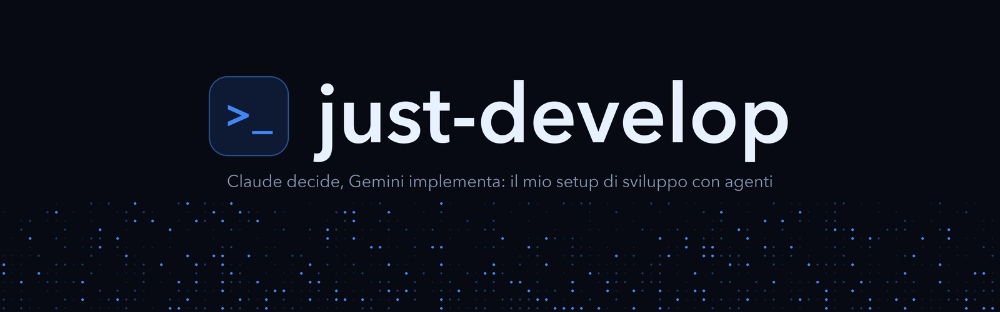

<p align="center"></p>

# just-develop

Il mio setup di sviluppo con agenti: Claude Code decide e scrive i ticket, Gemini in Antigravity li implementa e li rivede.

## Iniziare

Apri Claude Code in questa cartella e scrivi:

```text
Leggi SETUP.md e installa il setup.
```

Lo stesso file copre anche `Aggiorna il setup` e `Cerca MCP utili per me`.

## Cosa c'è

| File | A cosa serve |
|---|---|
| [`SETUP.md`](SETUP.md) | Istruzioni per l'agente: installazione, aggiornamenti, ricerca MCP |
| [`SETUP-REPO.md`](SETUP-REPO.md) | Analizza come lavorano gli agenti su un repo e lo allinea |
| [`flow.md`](flow.md) | Il flusso di lavoro, sempre attivo |
| [`flow-prompts.md`](flow-prompts.md) | Review, documentazione, Walkthrough, retro |
| [`GUIDE.md`](GUIDE.md) | Manuale rapido per te |
| [`GLOSSARY.md`](GLOSSARY.md) | I termini del flusso |
| [`DECISIONS.md`](DECISIONS.md) | Cosa è entrato nel setup, perché e da quali fonti |
| [`AGENTS.md`](AGENTS.md), [`CLAUDE.md`](CLAUDE.md) | Regole di questo repo per gli agenti |
| [`docs/`](docs/index.mdx) | Mappa del setup con i diagrammi; `docs/agents/` descrive ticket, etichette e dominio |
| [`shared/`](shared/global.md), [`personal/`](personal/global.md) | Regole globali |
| `skills/` | Skill del setup: `aim-higher`, `junior-deep-docs`, `ui-ux-doctrine` |
| `hooks/` | Blocchi su git distruttivo e lettura dei segreti |
| `scripts/sync-from-claude.py` | Allinea Antigravity a Claude Code |
| `tests/run.py` | Controllo di hook e sincronizzazione |
| `mcp.json` | Fonte unica dei server MCP |
