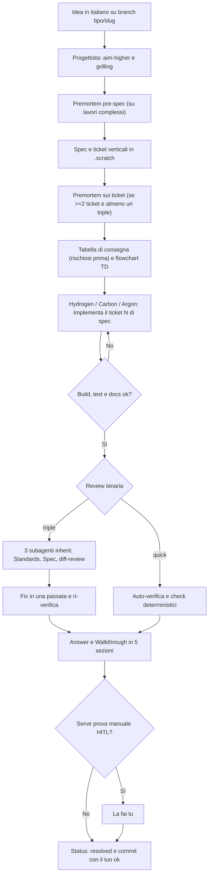
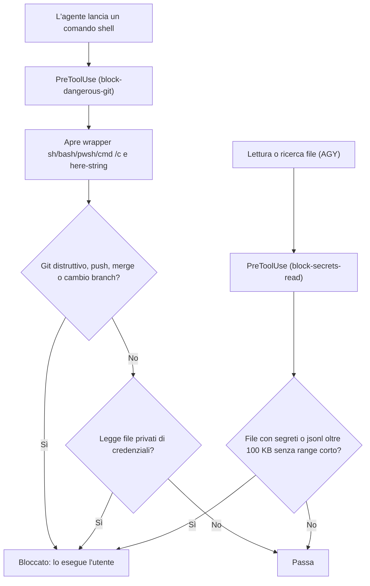
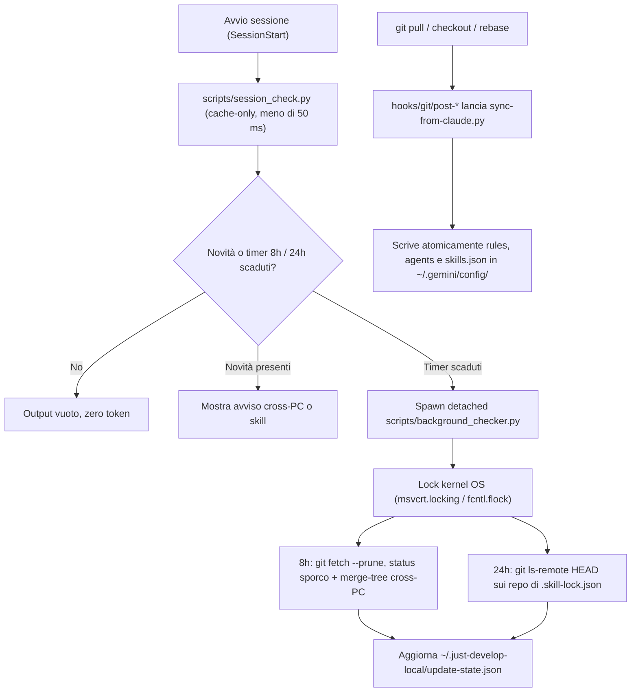

`just-develop` separa progettazione e implementazione tra Claude Code e Antigravity tramite regole always-on (`flow.md`), skill ([Guida alle skill](/skills)), guardrail deterministici e decisioni tracciate in `DECISIONS.md`.

## Da un'idea a un commit

## Chi fa cosa

| Attività | Chi | Modelli e motivo |
|---|---|---|
| Progettazione, grilling, spec, ticket | Progettista | `Sonnet 5.5 medium` (default), `Opus` su scelte difficili o bug complessi, `Carbon Medium` su AGY |
| Premortem su spec e ticket | Subagente `inherit` o `/swarm` (Claude e AGY) | Stesso modello del Progettista a contesto pulito, prima della spec (lavori complessi) e sui ticket (`>= 2` con almeno un `triple`) |
| Implementazione di un ticket | Esecutore in Antigravity | `Hydrogen Low` (`<= 30` righe meccaniche), `Hydrogen Medium` (default con test), `Carbon Medium` o `Argon Medium` dove i test non vedono l'errore |
| Review binaria e fix | Esecutore + 3 subagenti su `inherit` | `Review: quick` (`0` subagenti) su modifiche meccaniche/coperte da test; `Review: triple` (`Standards`, `Spec`, `diff-review`) su stato persistente, concorrenza/sicurezza o UI/AV |
| Branch, prova manuale, commit e merge | Tu | Creazione/cambio branch e merge su `main` sono bloccati agli agenti |

## Cosa bloccano gli hook

Claude Code usa `hooks/claude/block-dangerous-git.py`; Antigravity usa `hooks/antigravity/block-dangerous-git.js` e `hooks/antigravity/block-secrets-read.js`. Gli hook Git (`pre-commit`, `commit-msg`, `post-merge`, `post-checkout`, `post-rewrite`) verificano test, budget, anti-leak, formato dei commit e riallineano Antigravity dopo operazioni Git.

## Sync Claude-AGY e controllo silenzioso 8h / 24h

Per forzare subito il controllo di rete senza attendere il turno successivo esegui `python -X utf8 -I scripts/check-updates.py`.

## Catalogo completo dei file (`just-develop`)

| File | A cosa serve |
|---|---|
| `.claude/settings.json` | Configurazione di progetto Claude (`attribution` vuota, niente `Co-Authored-By`) |
| `.gitattributes` | Impone fine riga `LF` su `hooks/git/*` e `*.sh` anche su Windows con `core.autocrlf` |
| `.gitignore` | Esclusioni locali di Git |
| `AGENTS.md`, `CLAUDE.md` | Regole di questo repo, aree a rischio e comandi di verifica (`CLAUDE.md` importa `@AGENTS.md`) |
| `SETUP.md` | Istruzioni per l'agente: installazione, aggiornamento e ricerca MCP |
| `SETUP-REPO.md` | Analisi e allineamento di progetti `Repo versionato` o `Repo ibrido` |
| `flow.md` | Nucleo always-on (`<= 3.000 B`): ruoli, modelli, branching, puntatori e checklist chiusura ticket |
| `GUIDE.md`, `GLOSSARY.md` | Manuale operativo rapido e vocabolario dei ruoli e termini |
| `DECISIONS.md` | Registro datato delle decisioni prese, superate e fonti |
| `README.md` | Panoramica iniziale del repository |
| `shared/global.md`, `personal/global.md` | Regole globali condivise (inclusa regola segreti) e preferenze personali |
| `agents/contrarian.md` | Agente opzionale di premortem in Claude Code (`antigravity: false`) |
| `skills/flow-design/SKILL.md` | Skill universale di progettazione (`Entry Router`, `aim-higher`, grilling, spec/ticket, premortem, tabella) |
| `skills/implement-ticket/SKILL.md` | Skill universale di implementazione (`Pre-flight`, edit mirati, `docs/`, review `quick` o `triple` a 3 subagenti, `Answer`, Walkthrough, commit) |
| `skills/aim-higher/SKILL.md` | Ricerca su codice, documentazione ufficiale e web per principio, causa e 2-3 opzioni |
| `skills/junior-deep-docs/SKILL.md` | Metodo in 6 domande per documentare i moduli in `docs/` |
| `skills/ui-ux-doctrine/SKILL.md` | Regole di usabilità e accessibilità (Nielsen, WCAG 2.2 AA, 4 stati UI) |
| `hooks/claude/block-dangerous-git.py` | Guardrail Claude Code: git distruttivo, creazione/cambio branch, bypass `cmd /c` e lettura segreti shell |
| `hooks/antigravity/block-dangerous-git.js` | Guardrail Antigravity comandi shell: git distruttivo, branch e wrapper shell |
| `hooks/antigravity/block-secrets-read.js` | Guardrail Antigravity file/shell: segreti, filtri PowerShell sicuri e blocco `*.jsonl > 100 KB` senza range `<= 100` |
| `hooks/git/pre-commit` | Esegue `python -X utf8 -I tests/run.py` prima di ogni commit e controlla il formato branch (non bloccante su `HEAD` staccata) |
| `hooks/git/commit-msg` | Impone `tipo(ambito): descrizione` in max 15 parole senza `Co-Authored-By`, accettando merge/revert automatici Git/GitHub |
| `hooks/git/post-merge` | Riallinea `~/.gemini/config/` con `sync-from-claude.py` e azzera lo stato `behind` dopo `pull`/`merge` |
| `hooks/git/post-checkout` | Riallinea `~/.gemini/config/` al cambio branch (saltando checkout di singoli file, `--orphan` e rebase/bisect) |
| `hooks/git/post-rewrite` | Riallinea `~/.gemini/config/` e azzera `behind` dopo `rebase` |
| `scripts/sync-from-claude.py` | Sincronizza atomicamente regole, agenti e `skills.json` verso Antigravity e verifica MCP/guardrail (`--check`) |
| `scripts/session_check.py` | Hook `SessionStart` (`< 50 ms`, zero rete) che mostra novità e lancia il checker in background |
| `scripts/background_checker.py` | Worker staccato con lock kernel OS per il controllo 8h Git cross-PC e 24h `git ls-remote` skill/plugin |
| `scripts/check-updates.py` | Esegue in modo sincrono e interattivo lo stesso controllo aggiornamenti di `background_checker.py` |
| `scripts/extract-repo-retro.py` | Condensa a zero token le trascrizioni `.jsonl` Claude/AGY e il debito v2 di un repo (`SETUP-REPO.md`) |
| `tests/run.py` | Suite di test automatica su guardrail, `commit-msg`, sync, pipe/lock safety, budget token, anti-leak e `docs/` |
| `mcp.json` | Elenco condiviso dei server MCP generici |
| `docs/docs.json`, `docs/SUMMARY.md` | Configurazione navigazione Mintlify e indice GitBook |
| `docs/index.mdx`, `docs/skills.md` | Mappa del setup con catalogo file e guida completa alle skill |
| `docs/banner.png`, `docs/social-preview.png` | Asset grafici del repository e della documentazione |
| `docs/agents/domain.md`, `docs/agents/issue-tracker.md`, `docs/agents/triage-labels.md` | Regole di dominio, issue tracker locale `.scratch/` ed etichette triage per gli agenti |
