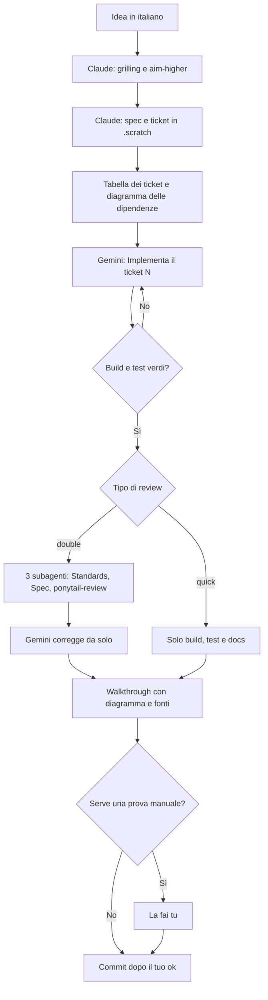
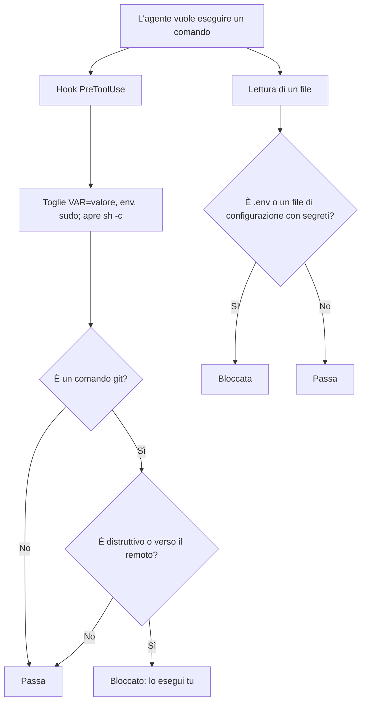
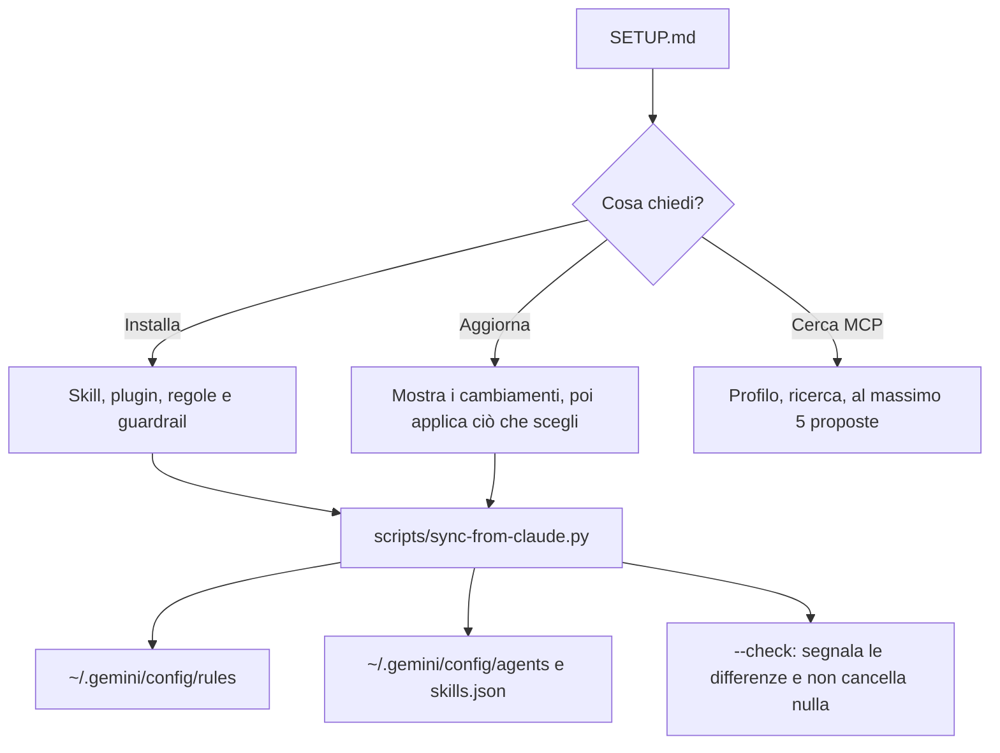

Questa pagina spiega il flusso. Le regole esatte sono in `flow.md`, le decisioni e le loro fonti in `DECISIONS.md`.

## Da un'idea a un commit

## Chi fa cosa

| Attività | Chi | Perché |
|---|---|---|
| Decidere, scrivere spec e ticket | Claude (Opus) | Un errore qui si scopre tardi |
| Implementare un ticket | Gemini Flash o Argon, secondo la riga `Esecutore:` | Flash dove test e build mostrano l'errore, Argon dove passa inosservato |
| Doppia Review e correzioni | Gemini, con 3 subagenti | Chi rivede parte da un contesto pulito |
| Prova manuale, commit e merge | Tu | Le decisioni sul prodotto e il remoto restano tue |

## Cosa bloccano gli hook

Claude Code usa `hooks/claude/block-dangerous-git.py`. Antigravity usa i due script in `hooks/antigravity/`. `tests/run.py` prova gli stessi casi su entrambi.

## Come arriva il setup agli agenti

## I file

| File | A cosa serve |
|---|---|
| `SETUP.md` | Istruzioni per l'agente: installazione, aggiornamenti, ricerca MCP |
| `flow.md`, `flow-prompts.md` | Il flusso di lavoro, la review e il Walkthrough |
| `GUIDE.md`, `GLOSSARY.md` | Manuale rapido e significato dei termini |
| `DECISIONS.md` | Ogni scelta con pro, contro e fonti |
| `shared/global.md`, `personal/global.md` | Regole globali |
| `hooks/` | Blocchi su git distruttivo e sulla lettura dei segreti, e controllo pre-commit |
| `scripts/sync-from-claude.py` | Allinea Antigravity a Claude Code |
| `tests/run.py` | Prova hook e sincronizzazione |
| `mcp.json` | Fonte unica dei server MCP |
| `docs/agents/` | Ticket, etichette e dominio per gli agenti |
